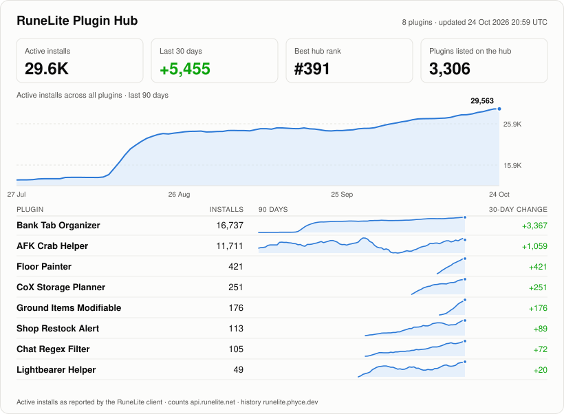

### RuneLite plugins

I write [RuneLite](https://runelite.net) plugins for Old School RuneScape. The card below is rendered every six hours from the Plugin Hub's own install counts.

<picture>
  <source media="(prefers-color-scheme: dark)" srcset="stats/overview-dark.svg">
  
</picture>

<!-- plugins:start -->
| Plugin | What it does | Installs | 30 days |
|---|---|---:|---:|
| [Bank Tab Organizer](https://runelite.net/plugin-hub/show/bank-tab-organizer) ([source](https://github.com/1504681/BankOrganizerPlugin)) | Organize your bank with category overlays, item sorting by stats/skill, and step-by-step reordering | 16,130 | +3,022 |
| [AFK Crab Helper](https://runelite.net/plugin-hub/show/afk-crab-helper) ([source](https://github.com/1504681/afk-crab-helper)) | Provides a distraction-reducing overlay when training on the Gemstone Crab | 11,284 | +888 |
| [Floor Painter](https://runelite.net/plugin-hub/show/floor-replacer) ([source](https://github.com/1504681/FloorReplacer)) | Paints every floor tile in the scene a single colour of your choice | 467 | +467 |
| [CoX Storage Planner](https://runelite.net/plugin-hub/show/cox-storage-planner) ([source](https://github.com/1504681/CoxStoragePlanner)) | Plan what to deposit and withdraw at each Chambers of Xeric storage unit, and track the doses you need for Olm | 251 | +251 |
| [Ground Items Modifiable](https://runelite.net/plugin-hub/show/ground-items-modifiable) ([source](https://github.com/1504681/GroundItemsModifiable)) | Ground Items with custom tile fill and outline colours, renameable items and item icons drawn on the ground | 217 | +217 |
| [Chat Regex Filter](https://runelite.net/plugin-hub/show/chat-regex-filter) ([source](https://github.com/1504681/ChatRegexFilter)) | Hides or rewrites any chatbox line that matches your regular expressions, whatever chat type it came from | 136 | +101 |
| [Shop Restock Alert](https://runelite.net/plugin-hub/show/shop-restock-alert) ([source](https://github.com/1504681/ShopRestockAlert)) | Times shop restock ticks, counts down with dings and shows when sold items clear so you can plan around the next restock | 107 | +72 |
| [Lightbearer Helper](https://runelite.net/plugin-hub/show/lightbearer-helper) ([source](https://github.com/1504681/LightbearerHelper)) | Highlights when to swap the Lightbearer for your other rings and pulses the spec orb when spec is ready | 58 | +37 |
<!-- plugins:end -->

Found a bug or want something added? Open an issue on the plugin's repo.
